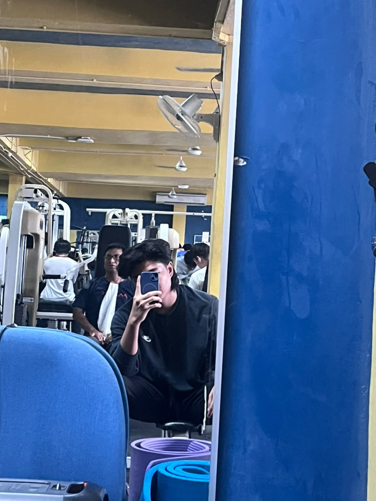

Hi! I'm **Qamarul Anuar Bin Hasrin**, a Software Engineering student at Universiti Malaya taking the Software Maintenance and Evolution course.

I mostly build full-stack web and mobile apps with **Node.js, React, Supabase and Expo**, and deploy them on Vercel and Railway. Most of my projects start small and keep growing, so I've learned the hard way how messy code gets when it isn't maintained.

- **Fun fact**: I run a TikTok tech and gadgets content channel on the side.
- **Course expectations**: To learn practical ways to read, refactor and evolve existing codebases, work with legacy systems, and collaborate properly through Git workflows like code review and pull requests.

